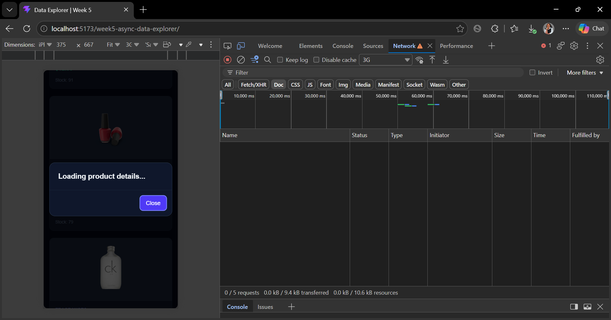
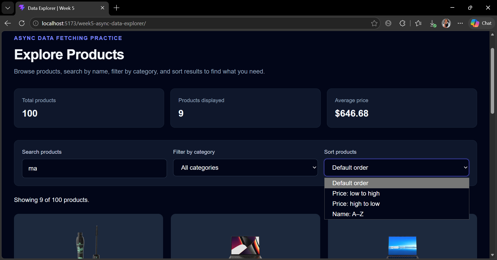
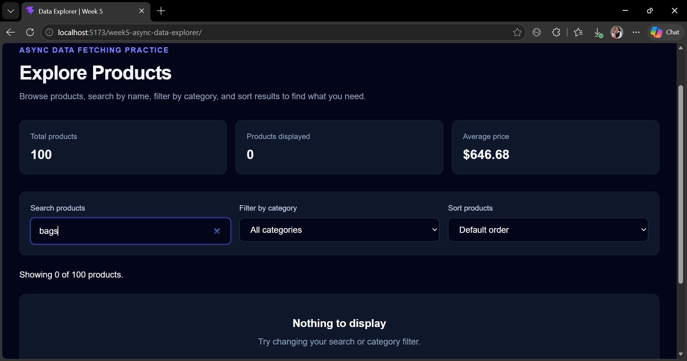
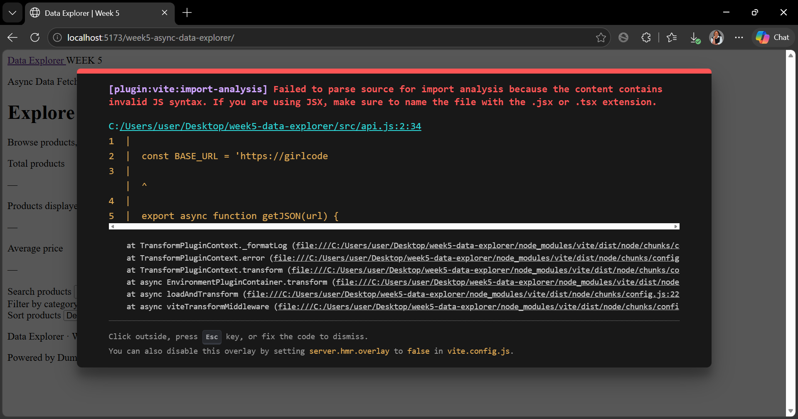

# Week 5: Async Data Fetching Practice — Data Explorer

## Project Overview

Data Explorer is a single-page web application developed as part of the Advanced Frontend Web Development Week 5 assignment.

The application fetches data from a public API and allows users to explore the data using search, filtering, sorting, and a details view.

The main goal of this project is to practise asynchronous JavaScript, API requests, data transformation, and rendering dynamic content.

## API Used

- **API:** DummyJSON Products API
- **API Endpoint:** https://dummyjson.com/products
- **API Documentation:** https://dummyjson.com/docs/products

> If your project uses a different API, replace the API information above with the API you actually used.

## Technologies Used

- HTML5
- Tailwind CSS v4
- JavaScript (ES Modules)
- Fetch API
- Async/Await
- Promise.all() or Promise.allSettled()
- Vite
- Git and GitHub
- GitHub Pages
- GitHub Actions

## Features

The project is designed to demonstrate the following features:

- Fetching data from a public API when the page loads.
- Using async/await and the Fetch API.
- Checking HTTP responses and handling errors.
- Displaying loading, success, error, and empty states.
- Searching data by text.
- Filtering data by category.
- Sorting data using JavaScript array methods.
- Displaying item details in a dialog or details panel.
- Using JavaScript modules with import and export.
- Making parallel requests with Promise.all() or Promise.allSettled().
- Displaying data in a responsive card layout.

Only list features that are implemented and working in your application.

## Project Links

**GitHub Repository:**  
https://github.com/saronelly123-ui/week5-async-data-explorer

**Live Website:**  
https://saronelly123-ui.github.io/week5-async-data-explorer/

**Demo Video:**  
https://drive.google.com/file/d/1H96w9QcBMV34OFuEujprTBhNW7NJvTgq/view?usp=sharing

## Screenshots

Add screenshots captured from the actual application.

### 1. Loading State



This screenshot should show the application while data is being fetched from the API.

### 2. Success State



This screenshot should show the successfully loaded data.

### 3. Empty State



This screenshot should show the message displayed when no results match the search or filter.

### 4. Error State



This screenshot should show the error message and Retry button when an API request fails.

## Application State and Rendering Flow

The application uses a state object to store the data and the current UI status.

Example state shape:

```js
const state = {
  items: [],
  status: "loading",
  error: null,
  query: "",
  filter: "all",
  sort: "default"
};
```

The application follows this general flow:

1. The page loads and starts fetching data from the API.
2. The state is updated to show the loading status.
3. When the request succeeds, the returned data is stored in the state.
4. When the request fails, the application stores an error message.
5. Search, filter, and sort update the relevant state values.
6. The render function updates the UI based on the current state.

The example above describes the intended state structure. It should match the actual state object used in the project.

## Example of API JSON and Data Transformation

Example of a shortened response from the DummyJSON Products API:

```json
{
  "products": [
    {
      "id": 1,
      "title": "Essence Mascara Lash Princess",
      "category": "beauty",
      "price": 9.99
    }
  ],
  "total": 194,
  "skip": 0,
  "limit": 1
}
```

The application can transform the returned data by extracting the products array, filtering items based on a search query or category, and sorting the results without changing the original array.

Example:

```js
const products = data.products;

const filteredProducts = products.filter(
  ({ title }) =>
    title.toLowerCase().includes(query.toLowerCase())
);
```

This example is for explanation. The API response and transformation code in the final README should correspond to the API and code actually used in the project.

## What I Learned About Async JavaScript

Through this project, I practised using the Fetch API to request data from a public API. I learned how async/await makes asynchronous code easier to read. I also practised checking HTTP responses and handling errors with try/catch. I learned how to transform API data using methods such as map, filter, find, reduce, and toSorted. I gained experience organizing JavaScript code into modules using import and export. I also learned how to manage application state and update the user interface when data changes. Finally, I practised deploying a Vite application using GitHub Pages.

## How to Run the Project Locally

### Prerequisites

- Node.js and npm
- Git
- Visual Studio Code or another code editor

### Installation

1. Clone the repository:

```bash
git clone https://github.com/saronelly123-ui/week5-async-data-explorer.git
```

2. Enter the project directory:

```bash
cd week5-async-data-explorer
```

3. Install dependencies:

```bash
npm install
```

4. Start the development server:

```bash
npm run dev
```

5. Open the local URL shown in the terminal.

### Build for Production

Run:

```bash
npm run build
```

Vite generates the production files in the `dist` directory.
## Demo Video

Watch the demonstration of the Async Data Fetching Practice project:

[Watch Demo Video on Google Drive](https://drive.google.com/file/d/1H96w9QcBMV34OFuEujprTBhNW7NJvTgq/view?usp=sharing)
## Author

**Saro Nelly Hornella Vanessa**

Advanced Frontend Web Development  
Week 5 — Async Data Fetching Practice